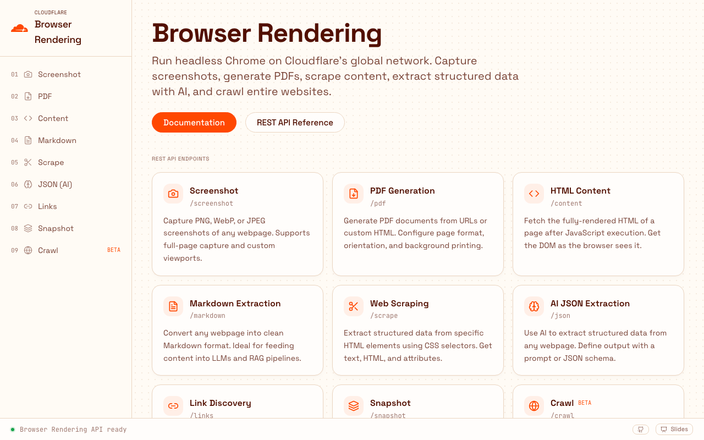
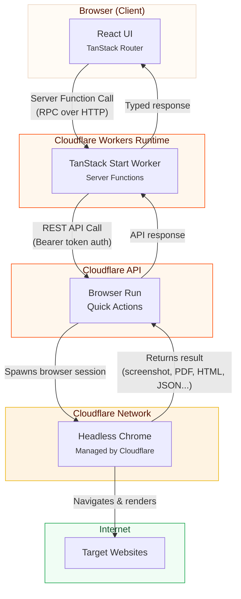

# Cloudflare Browser Run API Explorer

[](https://deploy.workers.cloudflare.com/?url=https://github.com/Gryczka/cloudflare-browser-rendering-demo)
[](LICENSE)
[](https://workers.cloudflare.com)

An interactive playground for the [Cloudflare Browser Run](https://developers.cloudflare.com/browser-run/) Quick Actions API — screenshots, PDFs, rendered HTML, Markdown, CSS scraping, AI-powered JSON extraction, link discovery, snapshots, and multi-page crawling. Built with [TanStack Start](https://tanstack.com/start) on [Cloudflare Workers](https://workers.cloudflare.com).

> **Naming note:** Browser Rendering was [renamed Browser Run](https://developers.cloudflare.com/changelog/post/2026-04-15-br-rename/) in April 2026. The REST endpoints are now called **Quick Actions**, and the Puppeteer/Playwright/CDP path is called **Browser Sessions**. The API path (`/accounts/{id}/browser-rendering/...`) and the `Browser Rendering - Edit` token permission are unchanged.

**Live demo:** https://cloudflare-browser-rendering-demo.dwarven.workers.dev/

---

[](https://cloudflare-browser-rendering-demo.dwarven.workers.dev/)

---

## What This Demonstrates

This project is a hands-on walkthrough of [Cloudflare Browser Run](https://developers.cloudflare.com/browser-run/), structured as an interactive playground where you can try every Quick Action directly in your browser.

| Concept | What You Learn |
| --- | --- |
| **Browser Run Quick Actions** | How to use Cloudflare's headless Chrome service via simple HTTP calls — screenshots, PDFs, content extraction, AI-powered JSON extraction, and full-site crawling |
| **Cloudflare Workers** | Serverless TypeScript running on Cloudflare's global edge network (300+ locations) |
| **TanStack Start** | Full-stack React framework with server functions that run natively on Workers |
| **Server Functions** | Type-safe RPC-style calls from the browser to the Worker backend — no manual API routes needed |
| **The Proxy Pattern** | How a Worker authenticates with the Cloudflare API on behalf of the user, keeping secrets server-side |
| **Vite + Cloudflare Plugin** | Modern dev experience with HMR, using `@cloudflare/vite-plugin` for seamless Worker development |

Each demo page lets you enter a URL, click **Run**, and see the API response in real time — with the exact request body and timing visible in the UI.

---

## Architecture



**How it works:**

1. The user interacts with the React UI (TanStack Router handles client-side routing)
2. Each demo page calls a **TanStack Start server function** — these execute on the Worker, not in the browser
3. The server function makes an authenticated Quick Actions call to the Browser Run API
4. Cloudflare spins up a headless Chrome instance, navigates to the target URL, and performs the requested action
5. The result (screenshot bytes, PDF, HTML, Markdown, structured JSON, etc.) flows back through the Worker to the UI

The Worker acts as a **thin proxy** — its only job is to inject the API token and forward the request. All secrets stay server-side.

---

## API Endpoints

The demo covers every Browser Run Quick Action available over REST:

| Endpoint | Method | Description |
| --- | --- | --- |
| `/screenshot` | POST | Capture PNG, WebP, or JPEG screenshots with full-page and custom viewport support |
| `/pdf` | POST | Generate PDF documents from URLs or raw HTML |
| `/content` | POST | Fetch fully-rendered HTML after JavaScript execution |
| `/markdown` | POST | Convert any webpage to clean Markdown (great for LLMs and RAG pipelines) |
| `/scrape` | POST | Extract structured data from specific elements using CSS selectors |
| `/json` | POST | AI-powered structured data extraction using a prompt or JSON schema |
| `/links` | POST | Discover all links on a page — useful for site mapping and SEO analysis |
| `/snapshot` | POST | Capture both a screenshot and rendered HTML in a single request |
| `/crawl` | POST | Start an asynchronous multi-page crawl with configurable depth and limits |
| `/crawl/:jobId` | GET | Poll crawl job status and retrieve results |

Not yet covered: [`/accessibilityTree`](https://developers.cloudflare.com/browser-run/quick-actions/accessibility-tree-endpoint/),
the multi-format [`/snapshot` `formats`](https://developers.cloudflare.com/browser-run/quick-actions/snapshot/) parameter,
and the [Browser Sessions](https://developers.cloudflare.com/browser-run/playwright/) half of the product.

---

## Demo Guardrails

This is deployed publicly without authentication, so every button spends real
Browser Run quota on the owner's account. Three layers keep that bounded — see
[`src/server/guards.ts`](src/server/guards.ts):

| Guard | Behaviour |
| --- | --- |
| **URL validation** | Rejects anything that is not a public `http(s)` URL. Loopback, RFC1918 private ranges, link-local (including the `169.254.169.254` metadata endpoint), and `.local`/`.internal` hosts are refused before any API call. |
| **Rate limiting** | The native [Workers rate limiting binding](https://developers.cloudflare.com/workers/runtime-apis/bindings/rate-limit/), keyed on client IP, with separate namespaces for Quick Actions (20/min) and crawl (3/min). Note these counters are per-Cloudflare-location and eventually consistent, so they bound bursts rather than global spend. |
| **Crawl ceilings** | `limit` is capped at 100 pages and `depth` at 5, versus the API's own maxima of 100,000 each. This is the control that actually bounds cost. |

Two crawl defaults are deliberate:

- **`render: false`** — non-rendered crawls run on Workers instead of a headless
  browser, consume no browser time, and are unbilled during the beta.
- **`crawlPurposes: ['search', 'ai-input']`** — the API default also includes
  `ai-train`, and any site whose [Content Signals](https://contentsignals.org/)
  set `ai-train=no` rejects the entire job with a `400`.

---

## Project Structure

```
.
├── src/
│   ├── server/
│   │   └── browser-rendering.ts    # All 10 server functions — the core API proxy layer
│   ├── routes/
│   │   ├── __root.tsx              # Root layout: sidebar + main content + status bar
│   │   ├── index.tsx               # Home page with endpoint grid
│   │   ├── screenshot.tsx          # Screenshot demo page
│   │   ├── pdf.tsx                 # PDF generation demo
│   │   ├── content.tsx             # HTML content demo
│   │   ├── markdown.tsx            # Markdown extraction demo
│   │   ├── scrape.tsx              # Web scraping demo
│   │   ├── json.tsx                # AI JSON extraction demo
│   │   ├── links.tsx               # Link discovery demo
│   │   ├── snapshot.tsx            # Snapshot (screenshot + HTML) demo
│   │   ├── crawl.tsx               # Async crawl demo with polling
│   │   └── slides.tsx              # Built-in presentation mode
│   ├── components/
│   │   ├── Sidebar.tsx             # Navigation sidebar
│   │   ├── DemoPage.tsx            # Shared layout for all demo routes
│   │   ├── CodeBlock.tsx           # Syntax-highlighted code display
│   │   ├── CrawlExplorer.tsx       # Rich crawl results viewer
│   │   ├── ResultToolbar.tsx       # Copy/download toolbar for results
│   │   └── ...                     # Badge, Callout, PillButton, StatusBadge, etc.
│   ├── slides/                     # 15-slide presentation system
│   │   ├── slides.ts               # Slide registry and metadata
│   │   ├── content/                # Individual slide content (one file per slide)
│   │   └── components/             # Slide layout, reveal animations, progress bar
│   ├── __tests__/                  # Vitest test suite
│   │   ├── components/             # Component tests (DemoPage, CodeBlock, etc.)
│   │   └── server/                 # Server function tests (all 10 endpoints)
│   ├── router.tsx                  # TanStack Router configuration
│   └── styles.css                  # Tailwind CSS v4 + custom Cloudflare design tokens
├── public/                         # Static assets (favicons, logos)
├── docs/
│   └── screenshot.png              # Demo UI screenshot
├── wrangler.jsonc                  # Wrangler configuration
├── vite.config.ts                  # Vite config with Cloudflare + TanStack plugins
├── vitest.config.ts                # Test runner configuration
├── tsconfig.json                   # TypeScript configuration
├── worker-configuration.d.ts       # Auto-generated Worker type definitions
├── .dev.vars.example               # Template for local environment variables
└── package.json
```

---

## Getting Started

### Prerequisites

- [Node.js](https://nodejs.org/) 18+
- A [Cloudflare account](https://dash.cloudflare.com/sign-up) (free tier works)
- [Wrangler CLI](https://developers.cloudflare.com/workers/wrangler/) (installed via `npm install`)

### Local Development

```bash
# 1. Clone the repo
git clone https://github.com/Gryczka/cloudflare-browser-rendering-demo.git
cd cloudflare-browser-rendering-demo

# 2. Install dependencies
npm install

# 3. Set up your environment variables
cp .dev.vars.example .dev.vars
# Edit .dev.vars and add your Cloudflare Account ID and API Token
# (Find your Account ID at https://dash.cloudflare.com → any zone → Overview → right sidebar)
# (Create an API Token at https://dash.cloudflare.com/profile/api-tokens)

# 4. Generate TypeScript types for your Worker bindings
npm run cf-typegen

# 5. Start the dev server
npm run dev
```

The dev server starts at `http://localhost:3000`. The Cloudflare Vite plugin simulates the Workers runtime locally, so server functions execute in a real Worker environment.

### Running Tests

```bash
npm run test
```

Tests cover all 10 server functions and key UI components using Vitest + Testing Library.

---

## Deploy to Cloudflare

```bash
# 1. Set your secrets
npx wrangler secret put CF_ACCOUNT_ID
npx wrangler secret put CF_API_TOKEN

# 2. Deploy
npm run deploy
```

Wrangler bundles the TypeScript, uploads the Worker script, and deploys static assets — all in one command. Your app will be available at `https://cloudflare-browser-rendering-demo.<your-subdomain>.workers.dev`.

---

## Key Concepts

### Cloudflare Browser Run

[Browser Run](https://developers.cloudflare.com/browser-run/) gives you access to headless Chrome instances running on Cloudflare's network. Instead of managing browser infrastructure yourself, you make API calls and Cloudflare handles the browser lifecycle. It splits into two halves:

- **Quick Actions** — one-shot HTTP endpoints for common tasks. This is what the demo covers.
- **Browser Sessions** — full [Puppeteer](https://developers.cloudflare.com/browser-run/puppeteer/), [Playwright](https://developers.cloudflare.com/browser-run/playwright/), or [CDP](https://developers.cloudflare.com/browser-run/cdp/) control for multi-step automation, with [Live View](https://developers.cloudflare.com/browser-run/features/live-view/) and [session recording](https://developers.cloudflare.com/browser-run/features/session-recording/).

Use cases include:

- **Screenshots & PDFs** — visual capture of any webpage
- **Content extraction** — get fully-rendered HTML/Markdown after JavaScript execution
- **Structured data** — AI-powered extraction of typed JSON from unstructured pages
- **Web crawling** — automated multi-page discovery with configurable depth

### TanStack Start Server Functions

[Server functions](https://tanstack.com/start/latest/docs/framework/react/server-functions) are TypeScript functions that execute on the server but are called from the client like regular async functions. In this project, every Browser Run call is wrapped in a server function (see `src/server/browser-rendering.ts`), which:

1. Reads the API credentials from environment variables (never exposed to the client)
2. Constructs the REST API request with proper authentication
3. Returns the typed response to the React component

This is the **proxy pattern** — the Worker sits between the browser and the Cloudflare API, keeping secrets safe while providing a clean typed interface.

### The Cloudflare Vite Plugin

The [`@cloudflare/vite-plugin`](https://developers.cloudflare.com/workers/frameworks/framework-guides/vite-plugin/) integrates Workers into the Vite dev server. Server functions run in a real Workers runtime (via Miniflare) during development, so `process.env`, KV bindings, and other Worker APIs work identically in dev and production.

---

## Built with Generative AI

This project was built extensively with the assistance of generative AI tools, including [Claude](https://claude.ai) (Anthropic) via [OpenCode](https://opencode.ai). AI was used throughout the development process:

- **Application code** — Server functions, React components, TanStack Router integration, and the slide presentation system
- **UI/UX design** — The Cloudflare-themed design system, component architecture, and interactive demo pages
- **Test suite** — Vitest tests covering all server functions and key components
- **Documentation** — This README, architecture diagrams, and inline code comments

The human author directed the design, reviewed and tested all outputs, and made all final decisions about content and structure.

---

## License

[MIT](LICENSE)
